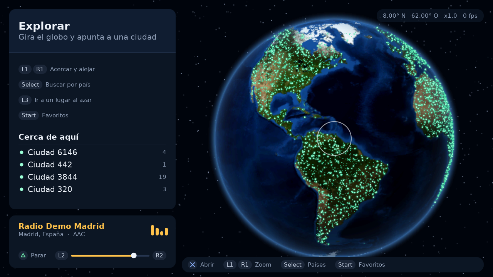

# Radio Garden PS3

Radio por internet de todo el mundo para PS3 con CFW/HEN (homebrew PSL1GHT), inspirada en [radio.garden](https://radio.garden).
Proyecto **no oficial** y sin relación con Radio Garden; usa su API pública no documentada.

| Cristal oscuro | Cristal claro |
|---|---|
|  |  |
| **Aero** | **Personalizado (RGB) — Menú** |
|  |  |
| **Buscar por país** | |
|  | |

> Las capturas se generan en PC con el mismo código de interfaz y **datos de ejemplo** (ciudades y emisoras ficticias): `make shots`.

## Controles

| Botón | Globo | Listas (emisoras, favoritos, países, ciudades) |
|---|---|---|
| Stick izq. / Cruceta | Girar el globo | Elegir |
| L1 / R1 | Zoom | Página arriba/abajo |
| Stick der. | Zoom | Zoom |
| ✕ | Abrir emisoras de la ciudad | Reproducir / entrar |
| □ | — | Favorito (emisoras), quitar (favoritos), teclado (países) |
| ○ | — | Volver |
| △ | Parar | Parar |
| L2 / R2 | Volumen | Volumen |
| L3 | Ir a una ciudad al azar | — |
| Select | Buscar por país | |
| Start | Menú: favoritos, países, tema, color RGB, TLS, lugar al azar | |
| R3 | Activar / desactivar verificación TLS | |

**Buscar por país:** Select abre la lista de países (con número de emisoras). □ abre un teclado en pantalla para filtrar
(sin distinguir acentos ni mayúsculas). ✕ en un país muestra sus ciudades ordenadas por emisoras y el globo vuela hasta ellas;
✕ en una ciudad abre sus emisoras.

## Rendimiento: todo en la GPU (RSX)
- El RSX dibuja el globo (esfera texturizada con iluminación en shader), los puntos de las ciudades
  (un único búfer estático; el shader de vértices los proyecta y oculta los de la cara oculta), las estrellas y la atmósfera.
- Los paneles se dibujan en el procesador solo cuando cambian y se suben como textura; la GPU los compone con transparencia
  encima del globo. Lo animado (ecualizador, spinner, mira) son sprites de GPU.
- El procesador apenas trabaja por fotograma, así que puede quedarse en 60 fps (contador arriba a la derecha).

## Temas
Cristal oscuro, Cristal claro, Aero (brillante, estilo años 2000) y Personalizado. En el Menú (Start) se cambia el tema y el
color con tres deslizadores R/G/B (en los temas fijos es el color de acento; en Personalizado tiñe todo el cristal).

Favoritos, tema, color, volumen y la última posición del mapa se guardan en `/dev_hdd0/game/RGDN00001/USRDIR/`.

## Formatos
MP3, AAC/HE-AAC (ADTS), Ogg Vorbis, HLS (TS o AAC empaquetado) y listas PLS/M3U.
No soportado: Opus, AAC dentro de MP4, HLS cifrado o fMP4.

## Compilar
GitHub Actions compila en cada push; descarga el artefacto `radio-garden-ps3` (`.pkg` para instalar).
Local: `export PS3DEV=... PSL1GHT=...; make pkg` (requiere libcurl, mbedTLS, zlib, libmad, faad2 y libvorbis de ps3libraries).
Recursos generados: `python3 tools/gen_assets.py` (fuente DejaVu Sans, máscara de tierra GLOBE/NOAA) y `python3 tools/gen_earth.py` (textura 4096x2048 de **NASA Blue Marble Next Generation**, dominio público, crédito: NASA Earth Observatory; requiere `pip install basemap-data`). Actions la genera en cada build.
