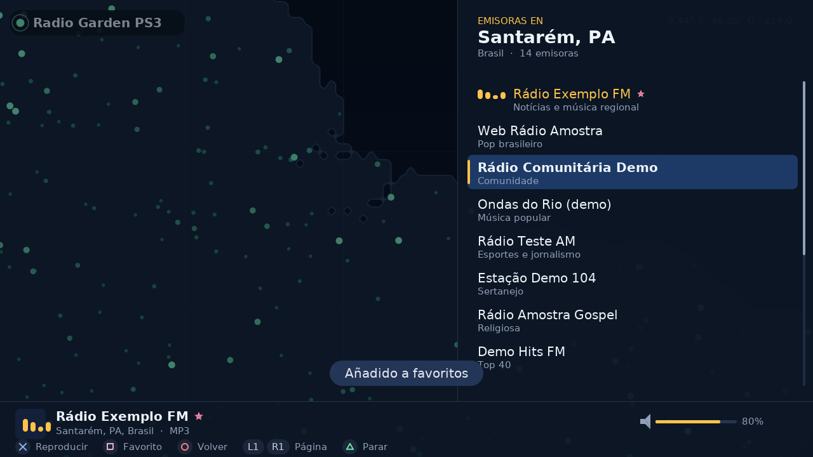

# Radio Garden PS3

Radio por internet de todo el mundo para PS3 con CFW/HEN (homebrew PSL1GHT), inspirada en [radio.garden](https://radio.garden).
Proyecto **no oficial** y sin relación con Radio Garden; usa su API pública no documentada.

| Mapa mundial | Ciudad bajo la mira |
|---|---|
|  |  |
| **Emisoras de la ciudad** | **Favoritos** |
|  |  |

> Las capturas se generan en PC con el mismo código de interfaz y **datos de ejemplo** (ciudades y emisoras ficticias): `make shots`.

## Controles

| Botón | Mapa | Lista de emisoras / Favoritos |
|---|---|---|
| Stick izq. / Cruceta | Mover el mapa | Elegir |
| L1 / R1, stick der. | Zoom | Página arriba/abajo |
| ✕ | Abrir emisoras de la ciudad | Reproducir |
| □ | — | Añadir / quitar favorito |
| ○ | — | Volver al mapa |
| △ | Parar | Parar |
| L2 / R2 | Volumen | Volumen |
| L3 | Ir a una ciudad al azar | — |
| Start | Abrir / cerrar Favoritos | |
| Select | Activar / desactivar verificación TLS | |

Favoritos, volumen y la última posición del mapa se guardan en `/dev_hdd0/game/RGDN00001/USRDIR/`.

## Formatos
MP3, AAC/HE-AAC (ADTS), Ogg Vorbis, HLS (TS o AAC empaquetado) y listas PLS/M3U.
No soportado: Opus, AAC dentro de MP4, HLS cifrado o fMP4.

## Compilar
GitHub Actions compila en cada push; descarga el artefacto `radio-garden-ps3` (`.pkg` para instalar).
Local: `export PS3DEV=... PSL1GHT=...; make pkg` (requiere libcurl, mbedTLS, zlib, libmad, faad2 y libvorbis de ps3libraries).
Recursos generados: `python3 tools/gen_assets.py` (mapa de tierra GLOBE/NOAA de dominio público vía `global-land-mask`, fuente DejaVu Sans).
