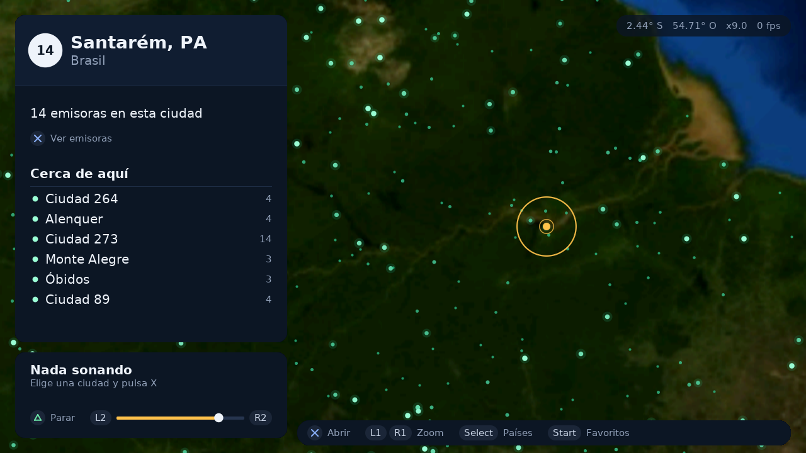
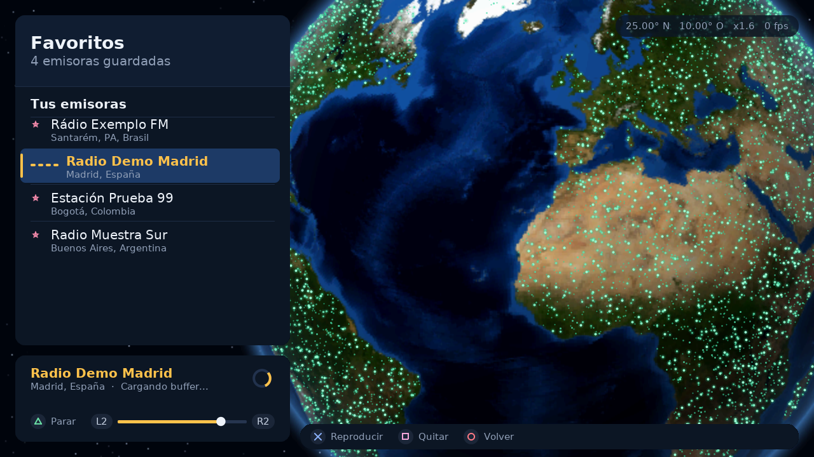
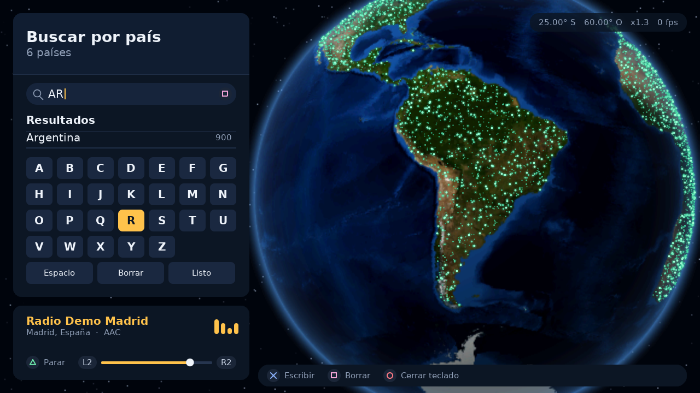

# Radio Garden PS3

Radio por internet de todo el mundo para PS3 con CFW/HEN (homebrew PSL1GHT), inspirada en [radio.garden](https://radio.garden).
Proyecto **no oficial** y sin relación con Radio Garden; usa su API pública no documentada.

| Globo 3D (NASA Blue Marble) | Ciudad bajo la mira |
|---|---|
|  |  |
| **Emisoras de la ciudad** | **Favoritos** |
|  |  |
| **Buscar por país** | |
|  | |

> Las capturas se generan en PC con el mismo código de interfaz y **datos de ejemplo** (ciudades y emisoras ficticias): `make shots`.

## Controles

| Botón | Globo | Listas (emisoras, favoritos, países, ciudades) |
|---|---|---|
| Stick izq. / Cruceta | Girar el globo | Elegir |
| L1 / R1 | Zoom | Página arriba/abajo |
| Stick der. | Zoom | Zoom |
| ✕ | Abrir emisoras de la ciudad | Reproducir / entrar |
| □ | — | Favorito (emisoras), quitar (favoritos), teclado (países) |
| ○ | — | Volver |
| △ | Parar | Parar |
| L2 / R2 | Volumen | Volumen |
| L3 | Ir a una ciudad al azar | — |
| Select | Buscar por país | |
| Start | Favoritos | |
| R3 | Activar / desactivar verificación TLS | |

**Buscar por país:** Select abre la lista de países (con número de emisoras). □ abre un teclado en pantalla para filtrar
(sin distinguir acentos ni mayúsculas). ✕ en un país muestra sus ciudades ordenadas por emisoras y el globo vuela hasta ellas;
✕ en una ciudad abre sus emisoras.

## Rendimiento (objetivo 60 fps)
- El globo se renderiza a media resolución desde una tabla precalculada (latitud/longitud e iluminación por píxel) que solo se
  recalcula al cambiar latitud o zoom; girar en longitud es un simple desplazamiento de textura.
- Mipmaps de la textura según el zoom; filtrado bilineal solo al ampliar. Escalado 2x bilineal.
- El trabajo se reparte entre los dos hilos de hardware del PPU.
- Los paneles se cachean y solo se redibujan al cambiar; el contador de FPS aparece arriba a la derecha.

Favoritos, volumen y la última posición del mapa se guardan en `/dev_hdd0/game/RGDN00001/USRDIR/`.

## Formatos
MP3, AAC/HE-AAC (ADTS), Ogg Vorbis, HLS (TS o AAC empaquetado) y listas PLS/M3U.
No soportado: Opus, AAC dentro de MP4, HLS cifrado o fMP4.

## Compilar
GitHub Actions compila en cada push; descarga el artefacto `radio-garden-ps3` (`.pkg` para instalar).
Local: `export PS3DEV=... PSL1GHT=...; make pkg` (requiere libcurl, mbedTLS, zlib, libmad, faad2 y libvorbis de ps3libraries).
Recursos generados: `python3 tools/gen_assets.py` (fuente DejaVu Sans, máscara de tierra GLOBE/NOAA) y `python3 tools/gen_earth.py` (textura 4096x2048 de **NASA Blue Marble Next Generation**, dominio público, crédito: NASA Earth Observatory; requiere `pip install basemap-data`). Actions la genera en cada build.
